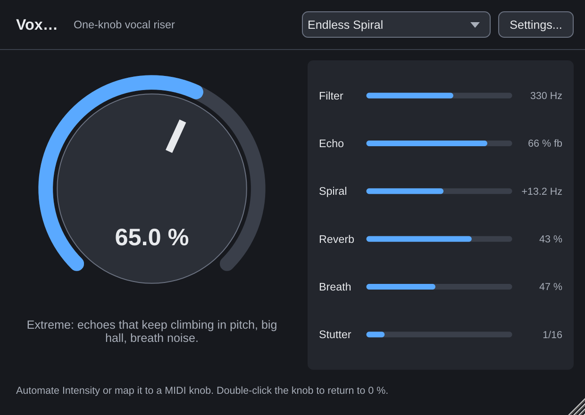

# VoxLift: riser para voces controlado con una sola perilla (VST3)

VoxLift crea build-ups, risers y transiciones con una sola perilla (**Intensity**), al estilo de los efectos "one-knob" de EDM. Es un diseño original, ajustado sobre todo para **voces**. Al subir la perilla, la voz se vuelve más fina, se llena de ecos y reverb, respira con ruido de aire y, según el preset, se entrecorta al tempo. Al llevarla de golpe a 0 se produce el drop: todas las colas se cortan y vuelve la voz limpia.



`docs/demo-all-presets.mp3` contiene los seis presets aplicados a una vocal sintética (vocal "a", 128 BPM): 2 compases en seco, 3,5 de subida, medio compás a 110 % y el drop.

## Uso

1. Insértalo en la pista de voz o en un bus de voces. Acepta entradas mono y estéreo, con salida estéreo.
2. Elige un preset.
3. Automatiza **Intensity** de 0 a 100 % a lo largo de la subida (8 o 16 compases). Otra opción es asignarlo a una perilla MIDI y tocarlo en vivo.
4. Opcional: sube a 110 % en el último medio compás para el silencio antes del drop. En la perilla, la zona de 100 a 110 % aparece en otro color.
5. En el drop, vuelve a 0 %. A 0 % la señal sale **bit a bit idéntica** a la entrada, porque el efecto queda en bypass real.

En **Settings...** están **Mix** (mezcla entre la voz original y el efecto) y **Output** (−12 a +6 dB).

## Qué hace la perilla

Un solo valor mueve toda esta cadena. Cada preset define, para cada efecto, en qué punto de la perilla entra, hasta dónde llega y con qué curva.

| Etapa | Qué hace | Ajuste para voz |
|---|---|---|
| **Filter** | Pasa-altos resonante (SVF) que sube de 20 Hz a entre 600 Hz y 2,2 kHz | Nunca supera 2,2 kHz (más arriba solo quedaría sibilancia) y la Q máxima es 1,6, para que no silbe en vocales sostenidas |
| **Drive** | Saturación suave (tanh) sobre la voz | Moderada; solo Radio Rise llega a 0,6 |
| **Stutter** | Puerta sincronizada al tempo, solo sobre la voz seca | El ritmo se duplica por pasos (1/8 → 1/16 → 1/32) y se alinea con el PPQ del DAW. Los ecos y la reverb siguen sonando debajo |
| **Echo** | Delay ping-pong sincronizado (1/16 a 1/4) | Lazo filtrado entre 300 Hz y 6,5 kHz para no acumular graves ni eses |
| **Spiral** | Desplazador de frecuencia (Hilbert) dentro del lazo del eco | Cada repetición sube unos Hz: la escalera "infinita" de tipo barber-pole |
| **Reverb** | Reverb estéreo (topología Freeverb, implementación propia) | Pasa-altos a 250 Hz en la entrada y amortiguación alta para domar la sibilancia |
| **Breath** | Ruido filtrado que sigue la envolvente de la voz | Respira con la cantante; con la pista en silencio no suena nada |
| **Duck** | Los ecos y la reverb bajan mientras se canta | Mantiene la letra inteligible al principio de la subida |
| **Width** | Ensancha en M/S solo la parte húmeda | La voz seca queda en el centro |
| **Hole** | De 100 a 110 % todo se desvanece a silencio | El silencio antes del drop |

Volumen: con una subida completa, el nivel queda unos **+3 a +6 dB** por encima de la voz en seco. Se midió con la herramienta `RenderDemo`.

### Presets

| Preset | Carácter | Para qué |
|---|---|---|
| Vocal Lift | Suave: pasa-altos hasta 900 Hz, ecos cortos, sala ligera | Pop, subidas discretas |
| Airy Choir | Reverb grande y ecos de negra que suben despacio | Baladas, hooks, coros |
| Radio Rise | Banda de teléfono que se estrecha, con grano y stutter de 1/8 a 1/16 | Hip-hop, intros, puentes |
| Stutter Build | Corte rítmico que acelera de 1/8 a 1/32 | EDM, big room |
| Endless Spiral | Extremo: ecos que suben de tono sin parar, sala grande, aire | Drops de festival |
| Whisper Wash | Íntimo: aire, reverb oscura y larga; la voz se disuelve hacia arriba | Downtempo, ambient |

## Compilar (Windows)

Requisitos: Visual Studio 2022 Build Tools, CMake ≥ 3.25 y Git. Compila desde una ruta corta, por ejemplo `C:\dev\VoxLift`.

```bash
cmake -S . -B build -G "Visual Studio 17 2022" -A x64
cmake --build build --config Release
ctest --test-dir build -C Release --output-on-failure
```

El resultado queda en `build/VoxLift_artefacts/Release/VST3/VoxLift.vst3`. Cópialo a `C:\Program Files\Common Files\VST3` o usa el instalador que genera el CI.

Herramienta auxiliar: `build/Release/RenderDemo.exe demo.wav` genera la demo de todos los presets. Sirve para ajustar curvas sin abrir un DAW.

## Arquitectura

```
Source/Core/    Sin JUCE: Dsp.h (SVF, delay, envolvente, ruido, Hilbert), Reverb, Presets, RiserEngine
Source/         Processor (APVTS), Editor, Theme.h (tokens), LookAndFeel (único)
Tests/          CoreTests (sin JUCE), EditorTests (editor real fuera de pantalla, contraste, estado)
Tools/          RenderDemo
installer/      Inno Setup 6
```

- Todo el sonido vive en `RiserEngine`. No reserva memoria en `process()`: los búferes se crean en `prepareToPlay`.
- La salida **no depende del tamaño de bloque del host**: los controles se actualizan con un reloj interno de 16 muestras que cruza los bloques. Hay una prueba que lo comprueba.
- Parámetros (`ParameterID` versión 1): `intensity` (0 a 110 %), `preset`, `mix`, `output`. El estado se guarda como `<VoxLift version="1">`. Se aceptan versiones anteriores y se rechazan las futuras.
- Latencia reportada: 0. Cola: 6 s.
- No hace falta pasar estado entre hilos con snapshots, porque todo el estado son parámetros del APVTS. Así se evita la duda sobre `std::atomic<std::shared_ptr>` (§2.6 de los estándares).

## Estado de verificación

| Elemento | Estado |
|---|---|
| Núcleo DSP: 3680 comprobaciones (bypass exacto a 0 %, independencia del tamaño de bloque, estabilidad con entrada extrema, silencio→silencio, drop < 50 ms, curvas monótonas) | **Verificado**: GCC 13, Linux |
| Editor y processor: 100 comprobaciones (contraste WCAG AA, foco y títulos accesibles, sin solapes en tamaño mínimo, normal y máximo, ida y vuelta del estado, rechazo de versión futura, bypass exacto, silencio a 110 %) | **Verificado**: JUCE 9.0.3, GCC 13, Linux sin pantalla |
| Compilación del VST3 con JUCE 9.0.3 | **Verificado en Linux** (incluye la generación de `moduleinfo`, que carga el plugin) |
| CPU | ~1 % de un núcleo, estéreo a 48 kHz, preset más pesado (Linux, -O2) |
| Compilación en Windows/MSVC, CI e instalador | **Sin probar**: los archivos siguen el patrón del proyecto de referencia |
| pluginval en CI | **Sin probar**: la URL de descarga de pluginval no se ha comprobado |
| FL Studio, REAPER, Ableton, Cubase | **Sin probar** en ningún DAW |
| Escucha con voces reales | **Pendiente**: los presets se ajustaron con una vocal sintética y midiendo el nivel |

## Pendiente

- Probar en FL Studio la automatización de Intensity. Al plugin original le fallaba ahí; aquí es un parámetro estándar del APVTS con gestos, pero no está comprobado.
- Ajustar los presets de oído con voces reales.
- Licencia: el proyecto usa **AGPL-3.0-or-later** (archivo `LICENSE`), porque JUCE se usa bajo AGPLv3. Para distribuirlo cerrado hace falta una licencia comercial de JUCE (§7.4 de los estándares).
- Firma de código del instalador.

"VST" es una marca registrada de Steinberg Media Technologies GmbH. VoxLift no está afiliado con Dada Life ni con Endless Smile.
